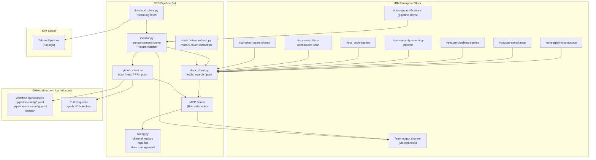

# SPS Pipeline Bot — POC & Feature Overview

**Document type:** Internal Engineering POC  
**Status:** Proof of Concept — validated, production-hardened, available for team adoption  
**Audience:** Engineering teams, platform leads, technical leads, engineering management  

---

## 1. Executive Summary

IBM Cloud Secure Pipeline Service (SPS) is the standard CI/CD platform for IBM Z products. SPS evolves continuously: scanning tools are replaced, pipeline base images are updated, credential retrieval APIs change, and security requirements tighten. Each of these changes is announced through Slack channels. Consuming teams — those who maintain repositories built on SPS — must monitor those announcements, determine whether the change affects them, identify which of their repositories are impacted, understand what modification is required, implement it across potentially many files and repositories, and raise pull requests for review.

Today, that entire chain is a manual, human-driven process. Announcements can sit unread for days. The translation from "SPS announcement" to "PR on the right repository" requires both SPS expertise and repository knowledge that not every engineer on every team possesses.

**SPS Pipeline Bot automates that chain.** It monitors the SPS announcement channels, classifies incoming messages, identifies which watched repositories are affected, surfaces the required change for engineer review, and — on explicit confirmation — raises a pull request. A parallel capability monitors pipeline execution and surfaces failure context or relevant troubleshooting threads when a build fails.

The tool is implemented as an IBM Bob MCP server. Bob (the AI assistant) provides reasoning; the bot provides the data layer and action layer. The result is a workflow where an engineer can go from "there's a new SPS announcement" to "PRs raised across all affected repos" through a guided conversation.

---

## 2. Problem Statement

### The current manual workflow

SPS changes are announced across multiple Slack channels: `#one-pipeline-announce`, `#devops-compliance`, `#secure-pipelines-service`, and `#ciso-security-scanning-pipeline`. There is no aggregation, no filtering, and no routing — a team engineer must monitor these channels personally.

When an announcement does arrive, the manual process looks approximately like this:

1. **Read and interpret the announcement.** Determine whether it is informational (a release note) or requires action (a breaking change, a deprecation, a migration).
2. **Assess applicability.** Determine which of the team's repositories use the affected pipeline feature. This typically means opening each repository and checking pipeline config files manually.
3. **Determine the required change.** Understand what modification the announcement requires — for example, replacing `get_env` with `get_secret` for secure values, or adding `opt-in-mend-sca: 1` to the compliance-checks step.
4. **Implement the change.** Edit the relevant YAML or shell script in each affected repository.
5. **Raise pull requests.** One per repository, with an appropriate title and description linking back to the original announcement.
6. **Monitor pipeline execution.** When a pipeline fails, determine whether it is a repository-side build failure or an SPS/infrastructure issue, locate the relevant error, and find the known resolution.

### Why this matters

- Announcements arrive at unpredictable times and are easily missed, particularly across large teams or during periods of high workload.
- The same change may need to be applied to many repositories. At time of writing, the watchlist covers 10 repositories across `github.ibm.com` and `github.com`.
- Translating an SPS announcement into a concrete code change requires SPS-specific knowledge that may be concentrated in a small number of individuals.
- Pipeline failure diagnosis typically requires navigating IBM Cloud's Tekton UI, reading raw step logs, and cross-referencing known issues in specialist Slack channels — a process that can take significant time when the cause is an SPS/infrastructure issue rather than a code defect.
- As SPS evolves more rapidly, the frequency and urgency of these changes is increasing.

---

## 3. Proposed Solution

SPS Pipeline Bot operates as a bridge between SPS announcements and repository changes, with a human review boundary at the point of code modification.

```
IBM SPS Announcement Channels (Slack)
        │
        ▼
   Announcement Ingestion
   (fetch_announcements — unprocessed messages only)
        │
        ▼
   Classification
   (keyword-based rule engine — 8 actionable categories)
        │
        ▼
   Repository Impact Analysis
   (scan watched repos for affected pipeline files)
        │
        ▼
   File Content Retrieval
   (read current pipeline configs for Bob to analyse)
        │
        ▼
   Change Generation + Diff Review  ← HUMAN REVIEW POINT
   (Bob proposes exact file changes; engineer confirms)
        │
        ▼
   Automated PR Creation
   (branch + commit + pull request on github.ibm.com)
        │
        ▼
   Pull Request Review + Merge       ← HUMAN REVIEW POINT
   (standard team code review process)
        │
        ▼
   Pipeline Execution (SPS)
        │
        ▼
   Failure Detection + Diagnosis
   (monitor notifications channel; fetch Tekton logs)
        │
        ▼
   Developer Notification (Slack webhook)
```

**What remains human-controlled:**
- Engineers confirm the proposed file change before any PR is raised
- Pull requests go through normal code review before merge
- The tool never directly modifies a production branch

---

## 4. Architecture and Workflow

### System components



### Key modules

| Module | Responsibility |
|---|---|
| `main.py` | MCP server — 11 tools exposed to Bob via the Model Context Protocol |
| `monitor.py` | Automated announcement runner (`--run`) and pipeline failure watcher (`--monitor`) |
| `slack_client.py` | All Slack I/O: read announcement channels, search troubleshooting threads, post webhook alerts |
| `github_client.py` | All GitHub I/O: parallel repo scanning, file retrieval, PR creation, branch pushes |
| `ibmcloud_client.py` | IBM Cloud Tekton API: IAM token exchange, step log retrieval, BUILD FAILURE detection |
| `slack_token_refresh.py` | macOS-native live extraction of Slack session credentials from the desktop app |
| `config.py` | Channel ID registry, repo list, state file management, optional `config.yaml` override loading |
| `setup_wizard.py` | Interactive one-command onboarding (`--setup`) |
| `doctor.py` | 9-check preflight health report (`--doctor`) |

### State management

The bot maintains a local state file (`.bob/sps-state.json`) containing processed Slack message timestamps. This prevents any announcement from being acted on more than once across repeated runs. State writes are append-only and the file is gitignored.

### Authentication

| Credential | Used for | How stored |
|---|---|---|
| `SLACK_USER_TOKEN` (`xoxc-`) | Reading Slack channels | Extracted live from Slack desktop app on macOS; or set manually in `.bob/mcp.json` |
| `SLACK_COOKIE` (`xoxd-`) | Slack session cookie | Same as above |
| `GITHUB_TOKEN` | Scanning repos, creating PRs | `.bob/mcp.json` (gitignored) |
| `SLACK_WEBHOOK_URL` | Posting outbound alerts | `.bob/mcp.json` (gitignored) |
| `IBM_CLOUD_API_KEY` | Fetching Tekton run logs | `.bob/mcp.json` (gitignored, optional) |

On macOS the Slack credentials are extracted automatically at startup from the Slack desktop app's on-disk storage (LevelDB + SQLite). The decryption key is derived once from macOS Keychain and cached to `.bob/slack-key.bin` (`chmod 600`). No credentials are ever committed to the repository.

---

## 5. Feature Overview

| Feature | What it does | User value | Status |
|---|---|---|---|
| **Announcement ingestion** | Fetches unprocessed messages from 4 SPS Slack channels; deduplicates via timestamp state | Engineers never miss an announcement; no duplicate processing | ✅ Implemented |
| **Keyword-based classification** | Routes messages to one of 8 actionable categories (or marks as informational) | Automatically distinguishes actionable changes from release notes and support questions | ✅ Implemented |
| **Parallel repo scanning** | Searches all watched repos simultaneously (4 threads) for files matching pipeline config patterns | Identifies affected repos in seconds rather than manually opening each one | ✅ Implemented |
| **File content retrieval** | Fetches current pipeline config files so Bob can read them before proposing a change | Enables accurate, context-aware change proposals against the real current state | ✅ Implemented |
| **Regex content search** | Searches all files in a repo for any pattern across all file types | Supports audit queries (e.g. "find all `get_env` usages in scripts/") beyond named pipeline files | ✅ Implemented |
| **Automated PR creation** | Creates branch, commits file changes, opens pull request with title, body, and announcement link | Reduces PR creation to a single confirmed action per repo | ✅ Implemented |
| **Push to existing branch** | Adds commits to an already-open PR branch | Supports iterative correction of open PRs without creating duplicates | ✅ Implemented |
| **Slack webhook notifications** | Posts a structured Block Kit alert to the team's output channel with repo, change summary, and PR link | Team visibility of all SPS changes affecting their repos, in one channel | ✅ Implemented |
| **Troubleshooting channel search** | Searches 5 specialist SPS Slack channels for threads matching an error message or keyword; includes thread replies | Surfaces known solutions without manual channel browsing | ✅ Implemented |
| **Pipeline failure detection** | Polls `#cics-sps-notifications` for failure notifications; identifies failures by attachment colour and text patterns | Continuous awareness of pipeline failures without manual monitoring | ✅ Implemented |
| **IBM Cloud log analysis** | Exchanges API key for IAM token; retrieves Tekton step logs; scans for `BUILD FAILURE` with surrounding context | Distinguishes build failures (application code) from SPS/infra failures at source | ✅ Implemented |
| **Repo watchlist management** | `add_repo` / `remove_repo` / `list_repos` tools manage a gitignored local `repos.json` | Each team maintains their own scope; no shared state | ✅ Implemented |
| **macOS token auto-refresh** | Extracts live Slack session token from desktop app LevelDB/SQLite at startup | No manual token maintenance; tokens never expire mid-session | ✅ Implemented |
| **Interactive setup wizard** | `--setup`: checks prerequisites, scaffolds `.bob/mcp.json`, copies repo template, runs bootstrap | New team onboarded in one command | ✅ Implemented |
| **Preflight doctor** | `--doctor`: 9-check health report (Python, packages, config, Slack key, repos, webhook, GitHub, Slack, IBM Cloud) | Confirms environment is correctly configured before first run | ✅ Implemented |
| **Team-level config overrides** | Optional `config.yaml` allows teams to set their own output channel, notification channel, and channel IDs | Portable across teams with different Slack channel structures | ✅ Implemented |
| **Scheduled daily automation** | `daily-run.sh` + launchd plist runs `--run` at 09:00 every day | Announcements are caught every morning without manual invocation | ✅ Implemented (macOS) |
| **Automated PR duplicate prevention** | Branch naming convention (`sps-bot/*`) and timestamp state prevent re-raising PRs for already-processed announcements | Idempotent operation; safe to run on a schedule | ✅ Implemented |
| **Multi-team configuration portability** | Channel IDs, output channel, and notification channel are overridable via `config.yaml` | Different teams with different Slack channels can adopt without modifying source code | ✅ Implemented |
| **Linux/Windows manual token support** | `SLACK_USER_TOKEN` and `SLACK_COOKIE` can be supplied manually in `.bob/mcp.json` | Not restricted to macOS, though Slack token extraction is not automated on other platforms | ✅ Implemented |
| **Dashboard / reporting** | Consolidated view of PR status across repos | — | ❌ Not implemented |
| **GitHub App authentication** | Token-free repo access via GitHub App installation tokens | — | ❌ Not implemented (PAT required) |
| **Linux Slack token extraction** | Automatic extraction from Slack desktop app on Linux | — | ❌ Not implemented |

### Supported SPS announcement categories

The classification engine currently recognises the following change types. All are derived directly from the `_RULES` list in `monitor.py`.

| Category | Trigger keywords | Action |
|---|---|---|
| `get_env` breaking change | `get_env cli will no longer`, `no longer support secure values`, `breaking change: get_env` | Replace `get_env` with `get_secret` in pipeline YAMLs and scripts. Deadline: 31 Aug 2026. |
| Mend SCA migration | `mend sca`, `opt-in-mend-sca`, `mend sca cli` | Add `opt-in-mend-sca: 1` and `mend-user-email` to the compliance-checks step |
| Base image update | `versioned base image`, `pipeline-base-ubi:` | Update pinned version tag in pipeline config |
| detect-secrets change | `detect-secrets`, `secrets baseline`, `.secrets.baseline` | Update detect-secrets step or baseline file |
| Code signing update | `garasign`, `code sign`, `csso-image-sign`, `ciso-sign` | Update code signing step configuration |
| `get_env` (general) | `get_env`, `secure values`, `pipeline environment` | Review use of `get_env` for secure values |
| ZAP v1 deprecation | `zap v1`, `dast-zap`, `zap scan` | Remove dast-zap v1 configuration; migrate to ZAP v2 |
| CRA deprecation | `cra deprecation`, `cra is deprecated`, `cra onboarding` | Migrate to Mend SCA |
| Release notes | `pipeline release:`, `release notes`, `backout plan`, `v11.`, `v10.` | Informational only — no action |
| Support questions | `describe the issue`, `facing the below issue`, `please do not post` | Informational only — no action |

---

## 6. End-to-End Example

**Scenario:** SPS announces that `get_env` will no longer support secure values after 31 August 2026. Teams must replace all usages with `get_secret`.

### Step 1 — Announcement arrives in #one-pipeline-announce

SPS posts: *"Breaking change: `get_env` CLI will no longer support secure values after 31 Aug 2026. Use `get_secret` instead."*

**Automation:** The next time `fetch_announcements` is called (either by the daily scheduled job at 09:00 or by the engineer asking Bob), the message is retrieved. Its timestamp is not in `.bob/sps-state.json`, so it is returned as a new, unprocessed message.

### Step 2 — Classification

**Automation:** `_classify()` matches the text against the `_RULES` list. The phrase `"get_env cli will no longer"` matches the highest-priority rule. The message is classified as category `get_env-breaking-change`, `action_required=True`, with file patterns `[".pipeline-config*.yaml", ".pipeline-scan-config.yaml", "scripts/"]`.

### Step 3 — Repository impact analysis

**Automation:** `scan_repos_tool()` is called with the matched file patterns. The tool searches all watched repositories in parallel (4 threads via `ThreadPoolExecutor`). It returns, for example:

```
CICS/cics-explorer-docs   → scripts/setup.sh
CICS/cics-cm-plugin       → scripts/setup.sh, .pipeline-config-ci.yaml
CICS/cics-pa-plugin       → scripts/setup.sh
```

Repositories with no matching files are silently excluded.

### Step 4 — Current file retrieval

**Automation:** `get_repo_files()` fetches the current content of each matched file. Bob reads the file content and identifies lines containing `get_env artif_user_value`, `get_env artif_token_value`, etc.

### Step 5 — Change proposal and engineer review

**Human step:** Bob presents the proposed diff — showing exactly which lines change from `get_env` to `get_secret` — and asks the engineer to confirm before proceeding. No code has been modified at this point.

### Step 6 — PR creation

**Automation (on confirmation):** `create_pr()` is called for each affected repository. It creates a new branch named `sps-bot/get-env-to-get-secret`, commits the modified files, and opens a pull request with the title `chore: migrate get_env to get_secret for secure values` and a description linking to the original announcement permalink.

### Step 7 — Standard code review

**Human step:** The team reviews and merges the PR through the normal review process. No automation is involved at this stage.

### Step 8 — Pipeline execution and monitoring

After merge, SPS runs the pipeline. If `--monitor` is running, it polls `#cics-sps-notifications`. If a failure notification arrives:

**Automation:** `get_failed_steps()` exchanges the IBM Cloud API key for an IAM bearer token, retrieves the Tekton step logs for the failed run, and scans each step log for the string `BUILD FAILURE`. If found, it captures 10 lines of context. If no BUILD FAILURE is found, it classifies the failure as an SPS/infrastructure issue.

### Step 9 — Notification

**Automation:** A Block Kit message is posted to the team's Slack output channel. For a build failure, it shows the failing step name and relevant log lines. For an SPS/infra issue, it surfaces up to 3 relevant threads from the troubleshooting channels with their first replies and permalink links.

---

## 7. Supported Use Cases

### UC-1: `get_env` → `get_secret` migration

**Trigger:** SPS announcement that `get_env` will stop supporting secure values  
**Detection:** Keywords `get_env cli will no longer`, `no longer support secure values`  
**Action:** Scan repos for `.pipeline-config*.yaml` and `scripts/`; propose replacement of `get_env <secret>` with `get_secret <secret>` in identified files  
**Output:** PR per affected repository  
**Human action required:** Confirm proposed diff; review and merge PR  

### UC-2: Mend SCA migration

**Trigger:** SPS announcement to migrate from Mend UA to Mend SCA CLI  
**Detection:** Keywords `mend sca`, `opt-in-mend-sca`  
**Action:** Scan repos for `.pipeline-scan-config.yaml`; propose addition of `opt-in-mend-sca: 1` and `mend-user-email` env vars to the compliance-checks step  
**Output:** PR per affected repository  
**Human action required:** Confirm proposed diff; supply `mend-user-email` value if not already present; review and merge PR  

### UC-3: Pipeline base image version update

**Trigger:** SPS announcement of a new versioned base image  
**Detection:** Keywords `versioned base image`, `pipeline-base-ubi:`  
**Action:** Scan repos for `.pipeline-config*.yaml`; propose updating the pinned version tag (repos using `:latest` require no change)  
**Output:** PR per affected repository, or informational notice if all repos use `:latest`  
**Human action required:** Confirm proposed diff; review and merge PR  

### UC-4: Code signing configuration update

**Trigger:** SPS announcement regarding GaraSign or CISO signing changes  
**Detection:** Keywords `garasign`, `code sign`, `csso-image-sign`, `ciso-sign`  
**Action:** Scan repos for `.pipeline-config*.yaml` and signing-related files; surface required configuration change  
**Output:** PR per affected repository  
**Human action required:** Confirm proposed diff; review and merge PR  

### UC-5: detect-secrets baseline update

**Trigger:** SPS announcement regarding detect-secrets step changes  
**Detection:** Keywords `detect-secrets`, `secrets baseline`, `.secrets.baseline`  
**Action:** Scan repos for `.pipeline-config*.yaml` and `.secrets.baseline`; surface required update  
**Output:** PR per affected repository  
**Human action required:** Confirm proposed diff; review and merge PR  

### UC-6: ZAP v1 deprecation

**Trigger:** SPS announcement that ZAP v1 dynamic scanning is deprecated  
**Detection:** Keywords `zap v1`, `dast-zap`, `zap scan`  
**Action:** Scan repos for `.pipeline-config*.yaml`; propose removal of dast-zap v1 configuration  
**Output:** PR per affected repository  
**Human action required:** Confirm proposed diff; review and merge PR  

### UC-7: Pipeline failure diagnosis

**Trigger:** Failure notification in the pipeline notifications Slack channel  
**Detection:** Attachment colour `#f2446f` or text containing `has failed` / `pipeline failed`  
**Action:** Retrieve Tekton step logs via IBM Cloud API; determine whether failure is a build failure or an SPS/infra issue; search troubleshooting channels if applicable  
**Output:** Slack alert to team output channel with failure context and/or troubleshooting thread links  
**Human action required:** Read the posted findings and take appropriate action  

### UC-8: On-demand troubleshooting

**Trigger:** Engineer pastes an error message or describes a build failure to Bob  
**Detection:** N/A — engineer-initiated via `search_troubleshoot_channels`  
**Action:** Search `#scs_code-signing`, `#scs-opensource-scan`, `#scs-sast`, `#cd-tekton-users-shared`, `#ciso-security-scanning-pipeline` for matching threads; return top results with replies  
**Output:** Synthesised answer with source thread links  
**Human action required:** Review and apply the suggested fix  

---

## 8. POC Validation

This POC demonstrates the following technical capabilities:

- **Programmatic SPS announcement consumption:** The IBM Enterprise Slack API is accessible using a user session token (`xoxc-`) and session cookie extracted from the Slack desktop app. The `conversations.list` restriction on enterprise Slack is worked around using hardcoded (configurable) channel IDs.
- **Accurate keyword-based classification:** 8 distinct actionable SPS change categories have been implemented and validated against real announcements received in the monitored channels.
- **Parallel multi-repository impact analysis:** GitHub code search (`filename:` queries) identifies affected repositories across a configurable watchlist in parallel. Path-prefix and glob post-filtering handles patterns like `.pipeline-config*.yaml`.
- **Safe, human-gated automated PR creation:** PRs are raised via the GitHub API on a dedicated `sps-bot/*` branch. Engineers review and confirm the change before `create_pr` is called. Merge remains entirely human-controlled.
- **Tekton log-based failure triage:** IBM Cloud pipeline run logs are retrieved via the CD Tekton API after IAM token exchange. BUILD FAILURE detection correctly distinguishes application-side failures from SPS/infrastructure failures.
- **Troubleshooting channel synthesis:** Slack `search.messages` with channel-scoped queries retrieves relevant threads including replies. This has been validated against known resolved issues in `#scs_code-signing` and `#cd-tekton-users-shared`.
- **Notification delivery via incoming webhook:** Block Kit messages are successfully delivered to team Slack channels using a standard incoming webhook URL — requiring no Slack admin access or bot token scopes.
- **End-to-end operation validated on CICS repositories:** The tool has been used to raise and merge PRs for the `get_env` → `get_secret` migration across CICS/cics-explorer, CICS/cics-explorer-doc, CICS/cics-explorer-dbfunc, CICS/cics-cm-plugin, CICS/cics-pa-plugin, and CICS/cics-explorer-docs.

---

## 9. Before vs After

| Activity | Before | With Automation |
|---|---|---|
| **Announcement monitoring** | Engineer manually watches 4 Slack channels | Daily scheduled job checks all 4 channels at 09:00; engineer alerted via team channel |
| **Change identification** | Engineer reads announcement and manually interprets what action is needed | Automated keyword classification maps message to action category and affected file patterns |
| **Repository identification** | Engineer checks each repository manually | Parallel GitHub code search across full watchlist; only affected repos returned |
| **Change implementation** | Engineer edits pipeline YAML/scripts in each repo manually | Bob proposes exact diff based on retrieved current file content; engineer confirms |
| **PR creation** | Engineer creates branch, commits changes, opens PR per repo manually | Single confirmed action creates branch, commits, and opens PR via GitHub API |
| **Pipeline monitoring** | Engineer watches pipeline notification channel; navigates IBM Cloud UI for log context | Automated polling detects failures; logs retrieved and parsed automatically |
| **Failure awareness** | Delayed — engineer notices only when actively watching Slack | Near-real-time: failure posted to team channel within 5 minutes of notification |
| **Troubleshooting** | Engineer manually browses 5 specialist channels | Keyword search across all 5 channels returns relevant resolved threads |
| **Onboarding / configuration** | Multiple manual file edits; no validation step | `sps-pipeline-bot --setup` wizard + `sps-pipeline-bot --doctor` preflight report |

---

## 10. Safety and Control

### Controls in place

**PR-based changes with explicit human confirmation**  
The `create_pr` tool will not execute without an explicit confirmation from the engineer in the Bob conversation. This is enforced in the MCP tool definition and documented in the Bob skill prompt. No code change is committed without a human seeing the proposed diff first.

**Pull request review before merge**  
All changes land on a `sps-bot/*` branch as a pull request. Merge follows the team's normal review process. The automation has no ability to merge.

**Repository scoping**  
The tool only operates on repositories in the user's local `repos.json` watchlist. It has no mechanism to discover or modify repositories outside this explicit list.

**Duplicate prevention**  
Processed Slack message timestamps are persisted to `.bob/sps-state.json`. A message that has already produced an action will not be processed again. Branch naming (`sps-bot/<descriptor>`) provides a secondary signal for identifying bot-raised PRs.

**Secret handling**  
Credentials are stored in `.bob/mcp.json` (gitignored, not committed). The Slack AES key cache is stored at `.bob/slack-key.bin` with `chmod 600`. Neither `--setup`, `--doctor`, nor any log output ever displays unmasked credential values.

**Error isolation**  
A failure in one repository's scan or notification does not terminate processing for other repositories. Errors are caught per-repo and logged as warnings.

**State safety**  
The `repos.json` watchlist is gitignored and local to each engineer's machine, preventing accidental cross-team repository scope pollution.

**Least-privilege GitHub access**  
Only `repo` scope (read + write to repositories) is required. No organisation-level, webhook, or admin permissions are needed.

**Outbound-only Slack access**  
Outbound notifications use a scoped incoming webhook URL tied to a single channel. The bot never requires a Slack bot token with broad write permissions.

**Preflight validation**  
The `--doctor` command validates all 9 subsystems before the tool is used in anger, providing actionable error messages rather than stack traces for expected configuration failures.

---

## 11. Production Readiness

This POC has undergone a production-hardening cycle. Key improvements over the initial implementation are documented in full in [`PRODUCTION_READINESS.md`](PRODUCTION_READINESS.md).

**Summary:**

| Area | Status |
|---|---|
| Installation | `pip install -e .` from repo root; `sps-pipeline-bot` CLI entry point installed |
| Onboarding | `sps-pipeline-bot --setup` interactive wizard; idempotent |
| Preflight validation | `sps-pipeline-bot --doctor` — 9 PASS/WARN/FAIL checks |
| Configuration | `.bob/mcp.json` for credentials; optional `config.yaml` for team-level overrides |
| Credential handling | No secrets committed; AES key cache `chmod 600`; tokens never logged |
| Error handling | Per-repo error isolation; defensive Slack metadata retrieval |
| Non-ASCII token handling | Token sanitisation prevents `UnicodeEncodeError` from LevelDB artefacts |
| Python version selection | `daily-run.sh` prepends pyenv shims to PATH, preventing launchd from picking up system Python 3.9 |
| Logging | Timestamped run log with Python version, outcomes per repo, and exit status |
| Tests | 9 unit tests across `test_setup.py` and `test_doctor.py`; all passing on Python 3.11 |
| Deployment | macOS local with launchd scheduling; see [`docs/automation-setup.md`](automation-setup.md) for IBM Cloud serverless deployment path |

---

## 12. Adoption / Quick Start

A new team can be up and running in under 10 minutes:

```
git clone https://github.ibm.com/anushka-p/sps-pipeline-bot.git
cd sps-pipeline-bot
pip install -e .
        ↓
sps-pipeline-bot --setup
(interactive: enter GitHub PAT, Slack webhook URL, IBM Cloud API key)
        ↓
sps-pipeline-bot --doctor
(confirms all 9 checks pass before first run)
        ↓
edit src/sps_pipeline_bot/repos.json
(add your team's repositories)
        ↓
sps-pipeline-bot --run
(fetch announcements, scan repos, post alerts)
```

For full installation instructions, configuration reference, and credential acquisition steps, see [README.md](../README.md).

For migration from an existing local setup, see [MIGRATION.md](../MIGRATION.md).

---

## 13. Limitations

The following limitations reflect the current POC implementation and should be understood before wider adoption.

**Classification coverage**  
The announcement classifier uses a keyword rule engine (`monitor.py:_RULES`). It correctly handles the 8 SPS change categories observed in practice. Announcements using unfamiliar phrasing will fall through to `action_required=False` and be flagged for manual review. New categories require a code change to add a rule. Bob (in interactive MCP mode) applies its own reasoning and is not limited by the rule list.

**macOS dependency for automatic token extraction**  
Automatic Slack session token extraction from the desktop app is implemented for macOS only. Engineers on Linux or Windows must manually provide `SLACK_USER_TOKEN` and `SLACK_COOKIE` in `.bob/mcp.json`. See [README.md](../README.md#manual-token-setup-non-macos) for the extraction procedure.

**Enterprise Slack channel enumeration**  
IBM Enterprise Slack blocks `conversations.list`. Channel IDs are therefore hardcoded as defaults in `config.py` and must be provided explicitly in `config.yaml` if a team's announcement channels differ from the defaults. Channel ID discovery requires a one-time lookup (right-click channel → Copy link in Slack).

**Tekton log retention**  
IBM Cloud Tekton pipeline run logs are retained for approximately 21–30 days. `get_failed_steps()` will time out for older runs. The bot handles this gracefully by falling back to troubleshooting channel search.

**No GitHub App support**  
Repository access uses a Personal Access Token. For teams that cannot or prefer not to use PATs, GitHub App support would be required. This is not currently implemented.

**No direct resolution of previously unseen announcements**  
For an announcement type that does not match any rule, the automated `--run` mode marks it as informational and does not generate a PR. Resolution requires the engineer to invoke the interactive Bob workflow and apply their own judgement.

**Single-machine scheduling**  
The scheduled daily runner (`daily-run.sh` + launchd) is designed for a single macOS workstation. For team-wide unattended scheduling, a server deployment is required (see `docs/automation-setup.md`).

---

## 14. Future Scope

The following enhancements are not currently implemented. They follow naturally from the existing architecture and are listed as potential directions for productionisation.

**Additional announcement classifiers**  
New SPS change categories can be added to the `_RULES` list in `monitor.py`. As SPS evolves, the classifier can be extended without modifying any other component.

**Broader repository discovery**  
Currently, the tool operates only on an explicit opt-in watchlist (`repos.json`). A future enhancement could discover all SPS-using repositories in an IBM GitHub organisation automatically, reducing the configuration burden for large teams.

**GitHub App authentication**  
Replacing Personal Access Tokens with short-lived GitHub App installation tokens would eliminate the need for individual PAT management and improve security posture for multi-user deployments.

**Linux/Windows Slack token extraction**  
Extending `slack_token_refresh.py` to support Slack's desktop app storage on Linux (`~/.config/Slack/`) or Windows would remove the macOS dependency for automatic token management.

**Server-side deployment**  
The architecture described in `docs/automation-setup.md` (IBM Cloud Code Engine + Trusted Profile + Secrets Manager) would enable team-wide unattended operation without any individual developer's machine being involved. This path is documented but not yet implemented.

**Configurable classification policies**  
Teams could override which announcement categories they care about (e.g. only receiving alerts for security-related changes) through `config.yaml` policy rules.

**PR status reporting**  
A `--report` command could query GitHub for the status of all `sps-bot/*` PRs across the watchlist, providing a consolidated view of pending SPS compliance work.

**Multi-channel notification routing**  
Currently all alerts go to one webhook-configured channel. Future work could route different change categories to different channels or individuals.

---

*Document generated from repository at commit `df6aa00`. All feature claims are derived from the implementation. Verify against the current repository state before distribution.*
