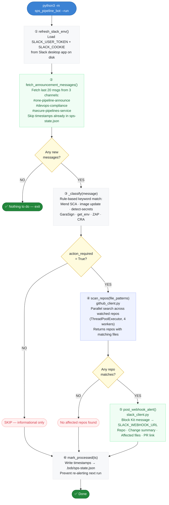

# SPS Pipeline Bot — Full Application Flow

This document describes the complete flow of both modes of the bot.

---

## Architecture overview

```
python3 -m sps_pipeline_bot
        │
        ├── (no flag)    → main.py          MCP server — Bob calls tools interactively
        ├── --bootstrap  → slack_token_refresh.py  One-time key setup
        ├── --run        → monitor.py       Announcement runner (runs once)
        └── --monitor    → monitor.py       Failure watcher (continuous loop)
```

**Source files (9 total):**

| File | Role |
|---|---|
| `__main__.py` | Entry point — routes flags to the right function |
| `main.py` | MCP server — all tool definitions Bob calls |
| `monitor.py` | Both automated loops: announcement runner + failure watcher |
| `slack_client.py` | All Slack I/O: read channels, search threads, post webhooks |
| `github_client.py` | All GitHub I/O: scan repos, create PRs, file helpers |
| `ibmcloud_client.py` | IBM Cloud log fetching — BUILD FAILURE detection |
| `slack_token_refresh.py` | macOS Slack token extraction + caching |
| `config.py` | Channel IDs, repo list, state file paths |
| `__init__.py` | Package marker |

**State on disk:**

| File | What's in it |
|---|---|
| `.bob/mcp.json` | Secrets: `GITHUB_TOKEN`, `SLACK_WEBHOOK_URL`, `IBM_CLOUD_API_KEY` |
| `.bob/slack-key.bin` | Cached AES key (derived from macOS Keychain on `--bootstrap`) |
| `.bob/sps-state.json` | Processed Slack timestamps (prevents re-processing) |
| `src/sps_pipeline_bot/repos.json` | Watched repos list |

---

## Mode 1 — Announcement runner (`--run`)

Runs once on a schedule. Fetches new SPS announcements, scans repos, posts alerts.



---

## Mode 2 — Pipeline failure monitor (`--monitor`)

Runs continuously. Polls the notifications channel, fetches the real error from IBM Cloud, posts a diagnosis.

```mermaid
flowchart TD
    START(["run_monitor()\nsleeps POLL_INTERVAL = 300s"])

    A["① refresh_slack_env()\nReload token + cookie"]

    B["② conversations_history()\nFetch last 20 msgs from\n#cics-sps-notifications\n(channel C07LS8K2DTQ)"]

    C{"ts in\nsps-state.json?"}
    SKIP1(["SKIP — already seen"])

    D{"_is_failure(msg)?\ncolor=#f2446f\nOR 'has failed' in text"}
    SKIP2(["SKIP — not a failure"])

    E["③ _extract_pipeline_info(msg)\nParse attachment blocks →\npipeline_name · run text · IBM Cloud URL"]

    F{"run_url present\nAND IBM_CLOUD_API_KEY set?"}

    FALLBACK["Use fallback query:\n'cics-explorer pipeline failed'"]

    G["④ get_failed_steps(run_url)\nibmcloud_client.py\n1. Exchange API key → IAM Bearer token\n2. GET /tekton_pipelines/{id}/runs/{id}/logs\n3. Scan each step log for 'BUILD FAILURE'\n4. Return context lines around it"]

    H{"BUILD FAILURE\nfound?"}

    SHOW["Show BUILD FAILURE step\n+ surrounding log context\nin Slack message\n(skip SPS channel search)"]

    SEARCH["⑤ search_troubleshooting(query)\nslack_client.py\nSlack search.messages across 5 channels:\n#scs_code-signing · #scs-sast\n#cd-tekton-users-shared\n#scs-opensource-scan\n#ciso-security-scanning-pipeline"]

    REPLIES["⑥ conversations_replies()\nFetch thread replies for each hit\n(replies usually contain the fix)"]

    J["⑦ _post_failure_analysis()\nBuild Block Kit payload:\nHeader · Pipeline name · Run link\nBUILD FAILURE lines OR search results\nUp to 3 threads with first reply + permalink"]

    K["⑧ httpx.post(SLACK_WEBHOOK_URL)\nDeliver to output channel"]

    L["⑨ mark_processed(all_ts)\nWrite → .bob/sps-state.json"]

    END(["✅ Analysis posted — sleep 300s → loop"])

    START --> A --> B --> C
    C -- YES --> SKIP1
    C -- NO --> D
    D -- NO --> SKIP2
    D -- YES --> E --> F
    F -- NO --> FALLBACK --> SEARCH
    F -- YES --> G --> H
    H -- YES --> SHOW --> J
    H -- NO --> SEARCH --> REPLIES --> J
    J --> K --> L --> END

    classDef step     fill:#f7f8fa,stroke:#e5e7eb,color:#1f2328
    classDef decision fill:#fffbdd,stroke:#d4a017,color:#1f2328
    classDef ibm      fill:#eef2ff,stroke:#a5b4fc,color:#1f2328
    classDef slack    fill:#f0fdf4,stroke:#86efac,color:#166534
    classDef skip     fill:#fff0f0,stroke:#fca5a5,color:#d73a49
    classDef terminal fill:#3b82d4,stroke:#2563a8,color:#ffffff
    classDef done     fill:#22863a,stroke:#166534,color:#ffffff

    class A,E,J,L step
    class C,D,F,H decision
    class G,K ibm
    class B,SEARCH,REPLIES slack
    class SKIP1,SKIP2,FALLBACK skip
    class START terminal
    class END done
```



---

## Mode 3 — Bob MCP tools (interactive)

When running as an MCP server (no flag), Bob calls these tools directly:

| Tool | What it does | Calls into |
|---|---|---|
| `ping` | Health check | — |
| `fetch_announcements` | Get unprocessed announcement messages | `slack_client.fetch_announcement_messages()` |
| `search_troubleshoot_channels` | Search SPS troubleshooting channels | `slack_client.search_troubleshooting()` |
| `scan_repos_tool` | Search watched repos for file patterns | `github_client.scan_repos()` |
| `get_repo_files` | Fetch specific file contents from a repo | `github_client.get_file_content()` |
| `create_pr` | Branch + commit changes + open PR | `github_client.create_pull_request()` |
| `post_webhook_alert` | Post a formatted Slack alert | `slack_client.post_webhook_alert()` |
| `list_repos` / `add_repo` / `remove_repo` | Manage the watchlist | `config.load_repos()` / `save_repos()` |

Bob orchestrates the full workflow — the tools provide data and actions, Bob does the reasoning.

---

## Key code references

| Step | Function | Module |
|---|---|---|
| Token refresh | `refresh_slack_env()` | `slack_token_refresh.py` |
| Read announcement channels | `fetch_announcement_messages()` | `slack_client.py` |
| Classify announcements | `_classify()` | `monitor.py` |
| Scan repos for files | `scan_repos()` | `github_client.py` |
| Post Slack alerts | `post_webhook_alert()` | `slack_client.py` |
| Detect pipeline failure | `_is_failure()` | `monitor.py` |
| Fetch IBM Cloud logs | `get_failed_steps()` | `ibmcloud_client.py` |
| Search troubleshooting | `search_troubleshooting()` | `slack_client.py` |
| Post failure analysis | `_post_failure_analysis()` | `monitor.py` |
| Track processed messages | `mark_processed()` | `config.py` |
