# `pipeline_monitor.py` — End-to-End Flow

How the monitor takes a Slack notification and posts a fix back to the team channel.

```mermaid
flowchart TD
    START(["`**run_monitor()**
    sleeps POLL_INTERVAL = 300 s`"])

    A["① **refresh_slack_env()**
    Reload SLACK_USER_TOKEN + SLACK_COOKIE"]

    B["② **conversations_history()**
    Fetch last 20 msgs from #cics-sps-notifications
    _(channel: C07LS8K2DTQ)_"]

    C{"`ts ∈ processed_ts?
    (~/.bob/sps-state.json)`"}

    SKIP1(["SKIP — already seen"])

    D{"`**_is_failure(msg)?**
    color=#f2446f  OR  'has failed' in text`"}

    SKIP2(["SKIP — not a failure"])

    E["③ **_extract_pipeline_info(msg)**
    Parse attachment blocks →
    pipeline_name · run text · IBM Cloud link"]

    F{"`run_url present
    AND IBM_CLOUD_API_KEY set?`"}

    FALLBACK["**FALLBACK query**
    _extract_search_query(info)
    strips suffix → 'cics-explorer pipeline failed'"]

    G["④ **get_failed_steps(run_url)**  _[ibmcloud_client]_
    1. Exchange API key → IAM Bearer token
    2. GET /pipeline_runs/{id}/logs → step log IDs
    3. Scan each log for errors → **FailedStep** list"]

    H["⑤ **search_troubleshooting(query)**  _[slack_client]_
    Slack search.messages across 5 channels:
    scs_code-signing · scs-sast · cd-tekton-users-shared
    scs-opensource-scan · ciso-security-scanning-pipeline"]

    I["⑤b **conversations_replies()**
    Pull thread replies for each hit
    _(replies usually contain the fix)_"]

    J{"`search_results
    empty?`"}

    NOFX["Post 'no fix found'
    suggest manual check"]

    K["⑥ **Build Block Kit payload**  _[_post_failure_analysis]_
    Header · Pipeline name · Status · Run link
    Root-cause log lines (≤4) · Up to 3 thread snippets
    with first reply + permalink"]

    L["⑦ **httpx.post(SLACK_WEBHOOK_URL)**
    Deliver formatted message to output channel"]

    M["⑧ **mark_processed(all_ts)**
    Write timestamps → ~/.bob/sps-state.json
    _(failures + non-failures, avoids re-processing)_"]

    END(["✅ Analysis posted — sleep 300 s → loop"])

    %% Main happy path
    START --> A --> B --> C
    C -- NO --> D
    C -- YES --> SKIP1

    D -- YES --> E
    D -- NO --> SKIP2

    E --> F
    F -- YES --> G --> H
    F -- NO --> FALLBACK --> H

    H --> I --> J
    J -- NO --> K --> L --> M --> END
    J -- YES --> NOFX --> M

    %% Styling
    classDef step      fill:#f7f8fa,stroke:#e5e7eb,color:#1f2328
    classDef decision  fill:#fffbdd,stroke:#d4a017,color:#1f2328
    classDef ibm       fill:#eef2ff,stroke:#a5b4fc,color:#1f2328
    classDef slack     fill:#f0fdf4,stroke:#86efac,color:#166534
    classDef skip      fill:#fff0f0,stroke:#fca5a5,color:#d73a49
    classDef terminal  fill:#3b82d4,stroke:#2563a8,color:#ffffff
    classDef done      fill:#22863a,stroke:#166534,color:#ffffff

    class A,E,K,M step
    class C,D,F,J decision
    class G,L ibm
    class H,I slack
    class SKIP1,SKIP2,NOFX,FALLBACK skip
    class START terminal
    class END done
```

## Key Code References

| Step | Function | Module | What it does |
|------|----------|--------|--------------|
| ① | `refresh_slack_env()` | `slack_token_refresh.py` | Reloads browser-extracted token + cookie before each poll |
| ② | `client.conversations_history()` | `slack_client._get_client()` | Pulls last 20 msgs from `#cics-sps-notifications` |
| ③ | `_is_failure()` → `_extract_pipeline_info()` | `pipeline_monitor.py` | Detects red attachment colour `#f2446f`; regex-parses pipeline name and IBM Cloud run URL |
| ④ | `get_failed_steps(run_url)` | `ibmcloud_client.py` | IAM token exchange → Tekton step logs → `FailedStep` with `search_query` |
| ⑤ | `search_troubleshooting(query)` | `slack_client.py` | `search.messages` + `conversations.replies` across 5 troubleshooting channels |
| ⑥ | `_post_failure_analysis()` | `pipeline_monitor.py` | Assembles Block Kit JSON: header + root-cause lines + thread snippets |
| ⑦ | `httpx.post(SLACK_WEBHOOK_URL)` | `pipeline_monitor.py` | Delivers the fix message via Incoming Webhook |
| ⑧ | `mark_processed(all_ts)` | `config.py` | Persists all seen timestamps so failures are never double-posted |
